# M485E Panel Signal 제어 설계 가이드

## 1. 목적

이 문서는 CANalyzer Panel에서 M485E 장치의 Signal 물리값을 조회하고 변경하는 구조를
정리한다. 특히 `Temperature`가 Register Map에서 `Signed`로 정의되고 `Scale`을 적용해
`25.5 °C`로 해석되는 경우를 기준으로 다음 내용을 설명한다.

- Register Raw 값과 Signal 물리값의 관계
- CAPL `float`와 `double`, System Variable, DLL 타입의 차이
- Panel, System Variable, CAPL, DLL 및 Register Map의 역할
- Device별 `Display Update`, `Send Changed`, Default Reset 동작
- 외부 Modbus Master와 Panel이 같은 Register Memory를 사용할 때의 주의사항

이 문서의 Panel 구조는 **설계 제안**이다. 현재 저장소에는 범용 Signal Read/Write Adapter는
있지만 Device별 전체 Signal Panel과 실제 `.xvp` 파일은 아직 없다.

## 2. 핵심 결론

1. 사용자가 설명한 실제 대상 Register Map 기준으로 `Temperature`는 `IEEE Float`가 아니라
   `Signed` 정수 Raw Signal이다. 현재 저장소의 예제 Map은 아직 `IEEE Float`이므로 별도
   정합화가 필요하다.
2. 이 문서의 `Scale=0.1` 설명 예시에서 Panel에는 Raw `255`가 아니라 Scale이 적용된
   물리값 `25.5`를 표시하고 입력한다.
3. 일반 Signal의 Panel System Variable은 64bit floating 형식으로 통일한다.
4. CAPL의 `float`와 `double`은 모두 8Byte이므로 CAPL 내부에서 정밀도 차이가 없다.
5. Register Map의 `IEEE Float`와 C++의 `float`만 4Byte라는 점을 구분한다.
6. 정확한 전체 범위 64bit Signed/Unsigned Raw는 물리값 `double` API가 아니라
   Direct Register `word[4]` 경로를 사용한다.
7. Device의 `Send`는 현재 API로 전체 원자 Write가 되지 않으므로 1차 Panel은 사용자가
   변경한 Dirty Signal만 순서대로 쓰는 `Send Changed` 방식이 적합하다.

## 3. 용어와 타입 구분

같은 `Float`라는 이름이 서로 다른 계층에서 다른 의미로 사용되므로 다음처럼 구분한다.

| 위치 | 타입 또는 표기 | 크기 | 의미 |
| --- | --- | ---: | --- |
| Register Map | `Signed` | `Size`에 따름 | 2의 보수 정수 Raw Signal |
| Register Map | `IEEE Float` | 4Byte | Register에 저장되는 IEEE 754 binary32 값 |
| Register Map | `IEEE Double` | 8Byte | Register에 저장되는 IEEE 754 binary64 값 |
| C++ | `float` | 4Byte | DLL 내부 IEEE Float Encode/Decode 임시값 |
| C++ | `double` | 8Byte | DLL Signal 물리값 API |
| CAPL | `float` | 8Byte | CAPL 64bit 실수형 |
| CAPL | `double` | 8Byte | CAPL 64bit 실수형, `float`와 동의어 |
| System Variable | `type="float", bitcount="32"` | 4Byte | 32bit floating System Variable |
| System Variable | `type="float", bitcount="64"` | 8Byte | Panel 물리값용 64bit floating System Variable |
| CAPL DLL Table | `F` | 8Byte | CAPL `float`와 C++ `double`을 연결하는 Vector ABI 타입 |

현재 설치된 Vector `cdll.h`에는 DLL Table의 `F`가
`float (means double in 8 Byte 80387 format)`으로 정의되어 있다. 따라서 C/C++의
`float=4Byte` 규칙을 CAPL `float`나 CAPL DLL Table의 `F`에 그대로 적용하면 안 된다.

프로젝트의 기존 `M485E::SignalControl::PhysicalValue`도 이미 다음과 같이 64bit floating으로
정의되어 있다.

```xml
<variable name="PhysicalValue" type="float" bitcount="64" ... />
```

관련 파일:

- [System Variable 정의](<../Config/System Variables/M485E.vsysvar>)
- [CAPL Core Wrapper](../Config/CAPL/M485E/M485E_Core.cin)
- [DLL CAPL Export Table](../src/M485E.Dll/M485E_CaplTable.cpp)
- [C++ Signal Codec](../src/M485E.Core/M485E_SignalCodec.cpp)

## 4. Signed Temperature 예제

### 4.1 Register Map 정의

사용자가 확정한 조건은 `Temperature`의 `Type=Signed`이고 Scale 적용 결과로 Panel에
물리값 `25.5 °C`를 표시한다는 것이다. Raw 값과 계산 과정을 구체적으로 보여주기 위해 이
절에서는 다음 항목을 **설명용으로 가정**한다.

- `Size=16`, `Length=2`
- `Scale=0.1`, `Offset=0`
- `Address=10006`, `Byte_Order=BigEndian`
- `Min=-40`, `Max=125`

실제 Register Map의 Scale, Offset, Size, Address와 Byte Order가 다르면 같은 공식에 실제
값을 대입해야 한다. 다음은 위 가정을 적용한 예시 행이다.

```csv
Address,SignalName,Type,Length,Byte_Order,Start_Bit,Size,Scale,Offset,Unit,Init_Value,Value_Table,Min,Max
10006,Temperature,Signed,2,BigEndian,0,16,0.1,0,degC,25.5,,-40,125
```

각 필드의 의미는 다음과 같다.

| 필드 | 값 | 의미 |
| --- | ---: | --- |
| `Address` | `10006` | Signal Frame의 첫 Register Address |
| `Type` | `Signed` | Raw 값을 2의 보수 부호 정수로 해석 |
| `Length` | `2` | Signal Frame은 2Byte, 즉 Register 1개 |
| `Start_Bit` | `0` | Frame의 최하위 Bit부터 Signal 시작 |
| `Size` | `16` | Raw Signal 폭은 16bit |
| `Scale` | `0.1` | Raw 1당 `0.1 °C` |
| `Offset` | `0` | 추가 Offset 없음 |
| `Init_Value` | `25.5` | Raw가 아닌 초기 물리값 |
| `Min`, `Max` | `-40`, `125` | Signal Write와 Init에 허용되는 물리값 범위 |

`Length`는 배열 길이가 아니라 Signal Frame의 Byte 크기다.

### 4.2 Register Raw에서 물리값 읽기

Signed/Unsigned Signal Read 공식은 다음과 같다.

```text
Physical = Raw × Scale + Offset
```

Register Raw가 `255`, Scale이 `0.1`, Offset이 `0`이면 다음과 같다.

```text
Physical = 255 × 0.1 + 0
         = 25.5 °C
```

16bit Register 값으로는 다음과 같다.

```text
Raw decimal : 255
Raw hex     : 0x00FF
Panel value : 25.5 °C
```

Panel과 CAPL은 `0x00FF`를 직접 실수로 해석하지 않는다. DLL이 Register Map의 `Signed`,
`Size`, `Scale`, `Offset`을 이용해 Raw `255`를 물리값 `25.5`로 변환한다.

### 4.3 Panel 물리값을 Register에 쓰기

Signal Write와 Init의 역변환 공식은 다음과 같다.

```text
RawCandidate = (Physical - Offset) / Scale
```

Panel에서 `25.5`를 입력하면 다음 순서로 처리한다.

```text
RawCandidate = (25.5 - 0) / 0.1
             = 255

Rounded Raw  = 255
Register     = 0x00FF
```

DLL은 다음 검증을 모두 통과한 경우에만 Register를 변경한다.

1. 입력값이 `NaN` 또는 무한대가 아닌지 확인한다.
2. 입력 물리값이 `Min=-40`, `Max=125` 안에 있는지 확인한다.
3. `(Physical - Offset) / Scale`을 계산한다.
4. Raw 후보가 정수가 아니면 가장 가까운 정수로 반올림하고, 정확히 절반이면 0에서
   멀어지는 방향으로 처리한다.
5. 결과가 Signed 16bit 범위 `-32768..32767` 안에 있는지 확인한다.
6. 검증된 Raw 값을 대상 Signal Bit 영역에 기록한다.

중간 검증이 하나라도 실패하면 대상 Register를 변경하지 않는다.

### 4.4 음수 온도 예제

`-12.5 °C`도 같은 방식으로 처리한다.

```text
Raw = (-12.5 - 0) / 0.1
    = -125
```

Signed 16bit의 `-125`는 2의 보수 `0xFF83`으로 저장된다.

```text
Register 0xFF83
→ Signed Raw -125
→ -125 × 0.1
→ -12.5 °C
```

이 예제는 Register에 IEEE Float `-12.5`의 비트열을 저장하는 것이 아니다. 정수 Raw
`-125`를 저장하고 Scale을 적용해 물리값을 얻는다.

### 4.5 Init Value와 Default Reset

`Init_Value=25.5`도 물리값이다. CSV Load 또는 Refresh 시 DLL은 이를 Raw `255`로 Encode해
초기 Register Image에 기록한다.

```text
CSV Init_Value 25.5
→ Raw 255
→ Register 0x00FF
```

`M485E_Core_ResetDevice(Index)`를 호출하면 해당 Device의 현재 Register Memory를 이 초기
Image로 되돌린다. 따라서 Default Reset 후 `Temperature`를 다시 읽으면 `25.5`가 반환된다.

## 5. Temperature Write/Read 전체 흐름

```mermaid
flowchart LR
    P["Panel 입력 25.5 °C"] --> S["64bit floating System Variable"]
    S --> U["CAPL UI 물리값"]
    U --> C["M485E_Core_WriteSignal"]
    C --> D["DLL double 물리값"]
    D --> E["Raw = round((25.5 - 0) / 0.1) = 255"]
    E --> R["Register 0x00FF"]

    R --> Q["M485E_Core_ReadSignal"]
    Q --> X["Physical = 255 × 0.1 = 25.5"]
    X --> V["Panel 표시 25.5 °C"]
```



`Temperature`의 Register 표현이 Signed 16bit이더라도 Panel과 CAPL/DLL의 Signal API는 Raw가
아닌 물리값을 64bit floating으로 전달한다. 이 때문에 정수형과 실수형 Signal의 Panel
전달 형식을 하나로 통일할 수 있다.

## 6. Panel, CAPL, DLL의 역할


| 구성 요소 | 소유하는 역할 | 소유하지 않는 역할 |
| --- | --- | --- |
| Panel | Device 탭, 입력칸, 버튼, 단위와 표시 형식 | Raw 변환, DLL 직접 호출 |
| System Variable | Panel과 CAPL 사이의 편집값·표시값 전달 | 실제 Register의 기준 상태 |
| CAPL UI | Button Event, 입력 Snapshot, Dirty 상태, 결과 게시 | Scale/Offset 및 Raw Codec |
| CAPL Core | Context, DLL ABI Adapter, 공통 오류 처리 | Panel Layout, Signal 표시 형식 |
| DLL/Core Runtime | CSV 검증, 현재 Register Memory, 동시 접근 Lock | Panel Control 생성 |
| Signal Codec | Signed/Unsigned/IEEE 변환, 범위와 정밀도 검증 | Device 탭과 버튼 처리 |
| Register Map | Address, Type, Size, Scale, Offset, Unit, Init | Panel의 배치 상태와 Dirty 상태 |

의존 방향은 다음과 같이 유지한다.

```text
Panel
  ↕ System Variable
CAPL UI
  ↓ 공개 Core API
CAPL Core
  ↓ 저수준 DLL ABI
M485E DLL / Runtime Register Memory
```

Panel은 DLL을 직접 호출하지 않고, CAPL UI와 Monitoring도 저수준 `M485E_Dll_*` 함수를
직접 호출하지 않는다. 저수준 DLL 호출은 CAPL Core에만 둔다.

## 7. CAPL float와 double 사용 규칙

CAPL 언어에서 `float`와 `double`은 모두 8Byte이고 표현 범위와 정밀도가 같다. 따라서
다음 두 선언 사이에 값 손실 차이는 없다.

```capl
float valueA = 25.5;
double valueB = 25.5;
```

다만 코드의 역할을 명확히 하기 위해 다음 표기 규칙을 권장한다.

```capl
// Panel과 공개 Core에서 사용하는 Signal 물리값
double physicalValue;

// Vector DLL Table의 F ABI를 호출하기 위한 저수준 Adapter 임시값
float abiPhysicalValue[1];
```

권장 공개 Wrapper 형태는 다음과 같다.

```capl
long M485E_Core_ReadSignal(long index, char signalName[],
     double& outPhysicalValue)
{
     float abiOutValue[1];
     long result;

     abiOutValue[0] = outPhysicalValue;
     result = M485E_Dll_ReadSignal(gM485E_ContextHandle, index,
          strlen(signalName), signalName, abiOutValue);

     if (result == M485E_OK)
          outPhysicalValue = abiOutValue[0];

     return result;
}
```

현재 구현은 공개 Core와 UI에서도 CAPL `float`를 사용한다. CAPL에서는 8Byte이므로 기능상
정밀도 손실은 없지만, 요구사항 문서의 `double` 표기 및 위 역할 규칙과 소스 명칭이 다르다.
향후 구현 단계에서 실제 CANalyzer 9.x/18 Measurement ABI를 확인한 뒤 문서, 소스와 시험을
함께 정렬해야 한다.

## 8. 권장 Device Panel 구조

### 8.1 Device 탭

Panel의 1차 구분은 Device로 한다.

```text
[Device A] [Device B] [Device C] ...
```

한 Device의 Signal이 너무 많으면 Device 탭 안에서 기능 그룹별 하위 탭 또는 Page로 나눈다.
Device 이름은 표시용으로 사용하고 System Variable Namespace에는 중복되지 않는 Index 또는
생성된 안정 식별자를 사용하는 것이 안전하다.

### 8.2 Signal 행

각 Signal 행은 다음 정보를 표시한다.

```text
Temperature [ 25.5 ] degC
```

- Label: `SignalName` 또는 별도 Panel 표시명
- 입력값: Scale이 적용된 물리값
- Unit: Register Map의 `Unit`
- 입력 범위: Register Map의 `Min`, `Max`
- 표시 소수점: Panel 전용 설정 또는 프로젝트 기본 규칙

`Temperature` 입력칸의 System Variable은 Signed 정수형이 아니라 64bit floating으로 둔다.
Signed는 Register Raw의 해석 방법이고 Panel 값 `25.5`는 물리값이기 때문이다.

### 8.3 Device별 System Variable 예시

```text
M485E::Panel::Device_0::Temperature
M485E::Panel::Device_0::DisplayUpdate
M485E::Panel::Device_0::SendChanged
M485E::Panel::Device_0::ResetDefault
M485E::Panel::Device_0::ResultCode
```

`Temperature`는 다음 형식으로 생성한다.

```xml
type="float" bitcount="64"
```

`type="float"`라는 XML 이름만 보고 32bit로 판단하지 않는다. 실제 System Variable 크기는
`bitcount="64"`가 결정한다.

## 9. Display Update

`Display Update`는 사용자가 버튼을 눌렀을 때 해당 Device의 현재 Signal 물리값을 Panel로
가져오는 명령이다.

```text
Display Update
→ Device의 Signal 목록 순회
→ M485E_Core_ReadSignal(Index, SignalName, Value)
→ 성공한 값만 각 System Variable에 게시
→ Panel 표시 갱신
```

이 명령은 기존 `Connection::Refresh`와 다르다.

| 명령 | 역할 |
| --- | --- |
| `Display Update` | 현재 Register Memory를 읽어 Panel 표시 갱신 |
| CSV `Refresh` | CSV를 다시 Load하고 새 `Init_Value`로 Runtime 전체 재구성 |

따라서 두 기능은 서로 다른 이름, System Variable과 CAPL Handler를 사용해야 한다.

Device의 Signal 수가 매우 많으면 한 CAPL Event에서 전부 읽지 않고 고정 개수씩 Timer로
나누어 처리한다. On-demand 방식은 주기적으로 모든 System Variable을 갱신하는 구조보다
평상시 부하가 낮다.

### 9.1 Display Update와 Dirty 보호

하나의 System Variable을 현재 표시값과 편집값으로 함께 사용하면 CAPL이 Display Update
값을 게시할 때도 `sysvar_update` 이벤트가 발생할 수 있다. 이를 사용자 편집으로 오인하면
읽어온 모든 Signal이 Dirty가 되는 문제가 생긴다.

CAPL UI는 Device별 Display Update 처리 중임을 나타내는 내부 Guard를 두고, Guard가 활성화된
동안 발생한 System Variable Update를 Dirty로 표시하지 않아야 한다.

```capl
gM485E_DisplayUpdateInProgress[deviceIndex] = 1;

// ReadSignal 성공값을 System Variable에 게시

gM485E_DisplayUpdateInProgress[deviceIndex] = 0;
```

또한 이미 사용자가 편집하여 Dirty인 Signal을 Display Update가 덮으면 미전송 입력값이
사라진다. 하나의 Value System Variable을 유지하는 1차 구조에서는 다음 정책을 권장한다.

1. Display Update는 Dirty가 아닌 Signal만 최신값으로 갱신한다.
2. Dirty Signal은 사용자의 편집값을 보존한다.
3. Result에는 갱신한 Signal 수와 Dirty로 건너뛴 Signal 수를 남긴다.
4. 사용자가 Dirty 값을 폐기하고 전체 최신값을 다시 받고 싶다면 별도의
   `Discard Changes + Display Update` 동작을 제공한다.
5. Send 성공 후 해당 Signal의 Dirty를 해제하고 필요하면 Read-back으로 표시값을 확인한다.

현재값과 편집값을 항상 동시에 보여줘야 한다면 `CurrentValue`와 `EditValue` System Variable을
분리하는 대안을 사용한다. 이 방식은 명확하지만 Signal 수가 많을 때 System Variable과 Panel
Control 수가 두 배가 되므로 1차 기본안에서는 사용하지 않는다.

## 10. Send Changed와 외부 Master

외부 Modbus Master의 FC10 Write와 Panel의 Signal Write는 같은 DLL Register Memory를
변경한다.


별도의 우선순위나 값 고정 기능이 없으면 정책은 **마지막 Write가 현재값**이다.

```text
Master Write → 현재 Register 변경
Panel Display Update → Master가 쓴 최신값 표시
Panel Send Changed → 선택한 Signal을 Panel 값으로 변경
다음 Master Write → 다시 Master 값으로 변경 가능
```

Panel 입력칸 하나를 표시값과 편집값으로 함께 사용할 때 모든 Signal을 무조건 전송하면 다음
문제가 생긴다.

- 사용자가 수정하지 않은 오래된 Panel 값이 최신 Master 값을 덮어쓸 수 있다.
- 여러 Signal 중 하나가 실패해도 앞에서 성공한 Signal은 이미 적용되어 있다.
- Signal별 DLL 호출 사이에 Master Write가 끼어들 수 있다.

따라서 1차 구조는 CAPL이 편집 이벤트를 감지해 Dirty 상태를 별도로 관리하고 Device 버튼에서
Dirty Signal만 보내는 `Send Changed`가 적합하다.

```text
Signal 편집
→ CAPL Dirty 표시
→ Send Changed
→ 입력 Snapshot 생성
→ Dirty Signal만 M485E_Core_WriteSignal 호출
→ Signal별 성공/실패 기록
→ 성공한 Signal의 Dirty 해제
```

현재 `WriteSignal`은 Signal 하나만 원자적으로 처리한다. Device의 모든 Signal을
All-or-Nothing으로 적용해야 한다면 CAPL 반복 호출이 아니라 신규 DLL Batch API가 필요하다.

## 11. Default 기능

### 11.1 Device Default Reset

현재 `M485E_Core_ResetDevice(Index)`를 통해 한 Device를 CSV `Init_Value` 상태로 원자 복원할
수 있다. Panel에는 이를 `Reset to CSV Default`로 표시하는 것이 명확하다.

Reset은 미전송 편집값까지 폐기하는 동작이므로 Dirty Signal이 있으면 먼저 사용자 확인을
받아야 한다. 성공하면 해당 Device의 Dirty를 모두 해제하고 `Display Update` 또는 Signal
read-back을 수행해 System Variable과 Panel 표시를 실제 Reset 결과로 맞춘다.

### 11.2 모든 Device Default Reset

현재 모든 Device를 한 번에 Reset하는 공개 API는 없다. CAPL에서 구성된 Device Index를
순회해 `ResetDevice`를 호출할 수 있지만 Device 전체 집합 기준으로는 원자적이지 않다.

1차 Panel에서 순차 Reset을 허용한다면 중간 실패 시 어느 Device까지 완료됐는지 Result에
남겨야 한다. 성공한 Device는 Dirty를 해제하고 read-back하며, 실패한 Device의 편집 상태는
유지한다. 모든 Device의 All-or-Nothing Reset이 필요하면 별도의 DLL API가 필요하다.

## 12. 현재 저장소와 제안 구조의 차이

### 12.1 현재 구현된 기능

- 범용 `Index + SignalName + PhysicalValue + Read + Write`
- 개별 Signal 물리값 Read/Write
- Address/Quantity 기반 Manual Register Write
- Device별 CSV Init 상태 Reset Core API
- `PhysicalValue` 64bit floating System Variable

### 12.2 아직 구현되지 않은 기능

- Device별 전체 Signal System Variable
- Device별 `Display Update`
- Dirty Signal 관리 및 `Send Changed`
- Default Reset Panel Handler
- 모든 Device Reset
- 실제 Device 탭 `.xvp` Panel
- Register Map 기반 Panel/System Variable/CAPL Mapping 자동생성기

### 12.3 현재 샘플 Register Map과의 차이

현재 [Device A 샘플 Register Map](../Config/Maps/M485E/M485E_DeviceA_RegisterMap.csv)의
`Temperature`는 `IEEE Float`로 정의되어 있다. 이 문서는 사용자가 설명한 실제 대상 Map의
`Type=Signed`를 설계 기준으로 반영했으며, `Scale=0.1`, `Offset=0`, `Size=16`, Address와
Min/Max는 변환 과정을 설명하기 위한 가정이다.

따라서 샘플 CSV를 실제 프로젝트 기준으로 사용할 경우 다음 단계에서 `Temperature` 행을
요구사항과 일치시켜야 한다. 이 문서 작업에서는 기존 CSV와 실행 코드를 변경하지 않는다.

### 12.4 Panel 전용 CSV 정보

현재 Register Map Loader는 다음 14개 Header와 Column 개수를 정확히 검사한다.

```text
Address,SignalName,Type,Length,Byte_Order,Start_Bit,Size,Scale,Offset,Unit,Init_Value,Value_Table,Min,Max
```

따라서 `Panel_Group`, `Display_Order`, `Decimals`, `Visible` 같은 Panel 전용 칼럼을 기존
Register Map에 바로 추가하면 현재 DLL Load가 실패한다.

기존 칼럼만으로 기본 Panel을 생성하고, 추가 Layout 정보가 필요할 때 별도의
`PanelMap.csv`를 두는 방식을 권장한다. 현재 Register Map의 `Length`는 배열 길이가 아니므로
Signal 배열 정보도 별도 명시가 필요하다.

## 13. 1차 권장안

1. Register Map은 Signal 변환의 단일 원본으로 유지한다.
2. 일반 Signal System Variable은 `type="float", bitcount="64"`로 통일한다.
3. CAPL 공개 물리값에는 의미가 명확한 `double` 표기를 사용한다.
4. 저수준 Vector `F` ABI Adapter에만 CAPL `float`를 사용한다.
5. Device별 `Display Update`, `Send Changed`, `Reset to CSV Default`를 제공한다.
6. Display Update 중에는 CAPL Guard로 프로그램 갱신을 Dirty 처리하지 않고, 기존 Dirty
   Signal의 편집값은 덮어쓰지 않는다.
7. CAPL 내부 Dirty 상태를 사용해 사용자가 변경한 Signal만 전송한다.
8. Device 전체 Send는 1차에서 순차 처리와 부분 성공을 명시한다.
9. 전체 원자 Write가 필수로 결정되면 DLL Batch API를 별도 설계한다.
10. 정확한 전체 범위 64bit 정수와 Signal이 없는 Register는 Manual Raw `word[]` 경로로
   처리한다.
11. Panel Layout 정보가 필요하면 기존 Register Map이 아니라 별도 `PanelMap.csv`로 관리한다.

## 14. 검증 항목

구현 단계에서는 최소 다음 항목을 확인한다.

- Signed Temperature `Raw 255 → 25.5 °C` Read
- Panel `25.5 °C → Raw 255 → Register 0x00FF` Write
- Signed Temperature `Raw -125/0xFF83 → -12.5 °C` Read
- `Init_Value=25.5` Load 및 Device Reset 후 `25.5` 복원
- Min/Max 경계 `-40`, `125` 허용 및 범위 밖 Write 거부
- Write 실패 시 Register 값 유지
- Master Write 후 Display Update에서 최신 물리값 표시
- Display Update의 프로그램 갱신이 Dirty를 발생시키지 않음
- Dirty 편집값이 Display Update에 의해 덮어써지지 않음
- Dirty Signal만 Send하고 미수정 Signal의 Master 값 유지
- Device Send 중간 실패의 부분 성공 Result 표시
- CANalyzer 9.x/18에서 CAPL `F`와 C++ `double` 왕복
- Float32로는 정확히 표현할 수 없는 `16777217.0`을 사용한 8Byte ABI 정밀도 검증
- 정확한 64bit 정수의 Direct Register `word[4]` 왕복

## 15. 관련 요구사항과 코드

- `FR-SIG-025~041`: Init 물리값, Scale/Offset, 반올림, 범위 및 Double 정밀도
- `FR-UI-001~021`: Panel/System Variable과 CAPL UI 역할
- `IF-API-017~018`: Signal Read/Write Core 및 DLL API
- [요구사항 명세](REQUIREMENTS_SPEC.md)
- [프로젝트 개요](PROJECT_OVERVIEW.md)
- [CAPL UI](../Config/CAPL/M485E/M485E_UI.cin)
- [CAPL Core](../Config/CAPL/M485E/M485E_Core.cin)
- [DLL Signal API](../src/M485E.Dll/M485E_DllApi.cpp)
- [Signal Codec](../src/M485E.Core/M485E_SignalCodec.cpp)
