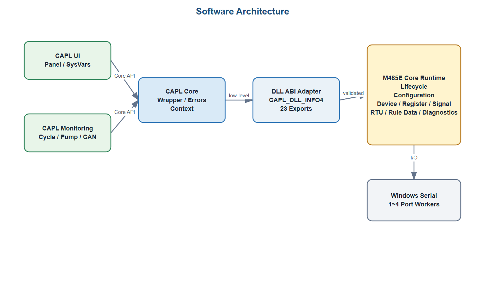

# M485E Panel Signal 제어 설계 가이드

## 1. 목적

이 문서는 CANalyzer Panel에서 M485E 장치의 Signal 물리값을 조회하고 변경하는 구조를
정리한다. 특히 `Temperature`가 Register Map에서 `Signed`로 정의되고 `Scale`을 적용해
`25.5 °C`로 해석되는 경우를 기준으로 다음 내용을 설명한다.

- Register Raw 값과 Signal 물리값의 관계
- CAPL `float`와 `double`, System Variable, DLL 타입의 차이
- Panel, System Variable, CAPL, DLL 및 Register Map의 역할
- Device별 `Display Update`, `Send Changed`, Default Reset 동작
- 외부 Modbus Master와 Panel이 같은 Register Memory를 사용할 때의 주의사항

v0.6.0은 이 구조를 `Panel_Generator.exe`, 생성 CAPL/System Variable DB와 복사·붙여넣기용
XVP Fragment로 구현한다. 저장소는 회사 전체 Panel이나 Tab을 포함하지 않으며 생성된 GroupBox를
기존 Panel에 복사하는 방식만 제공한다.

## 2. 핵심 결론

1. 저장소 Sample Register Map의 `Temperature`는 `IEEE Float`이며 Generator는 이를 그대로
   사용한다. `Signed + Scale=0.1` Temperature는 Codec 설명과 자동시험용 합성 Fixture일 뿐
   회사 Register Map의 내용을 추정하지 않는다.
2. 이 문서의 `Scale=0.1` 설명 예시에서 Panel에는 Raw `255`가 아니라 Scale이 적용된
   물리값 `25.5`를 표시하고 입력한다.
3. 일반 Signal의 Panel System Variable은 64bit floating 형식으로 통일한다.
4. CAPL의 `float`와 `double`은 모두 8Byte이므로 CAPL 내부에서 정밀도 차이가 없다.
5. Register Map의 `IEEE Float`와 C++의 `float`만 4Byte라는 점을 구분한다.
6. 정확한 전체 범위 64bit Signed/Unsigned Raw는 물리값 `double` API가 아니라
   Direct Register `word[4]` 경로를 사용한다.
7. Device의 `Send`는 현재 API로 전체 원자 Write가 되지 않으므로 1차 Panel은 사용자가
   변경한 Dirty Signal만 순서대로 쓰는 `Send Changed` 방식이 적합하다.

## 3. 용어와 타입 구분

같은 `Float`라는 이름이 서로 다른 계층에서 다른 의미로 사용되므로 다음처럼 구분한다.

| 위치 | 타입 또는 표기 | 크기 | 의미 |
| --- | --- | ---: | --- |
| Register Map | `Signed` | `Size`에 따름 | 2의 보수 정수 Raw Signal |
| Register Map | `IEEE Float` | 4Byte | Register에 저장되는 IEEE 754 binary32 값 |
| Register Map | `IEEE Double` | 8Byte | Register에 저장되는 IEEE 754 binary64 값 |
| C++ | `float` | 4Byte | DLL 내부 IEEE Float Encode/Decode 임시값 |
| C++ | `double` | 8Byte | DLL Signal 물리값 API |
| CAPL | `float` | 8Byte | CAPL 64bit 실수형 |
| CAPL | `double` | 8Byte | CAPL 64bit 실수형, `float`와 동의어 |
| System Variable | `type="float", bitcount="32"` | 4Byte | 32bit floating System Variable |
| System Variable | `type="float", bitcount="64"` | 8Byte | Panel 물리값용 64bit floating System Variable |
| CAPL DLL Table | `F` | 8Byte | CAPL `float`와 C++ `double`을 연결하는 Vector ABI 타입 |

현재 설치된 Vector `cdll.h`에는 DLL Table의 `F`가
`float (means double in 8 Byte 80387 format)`으로 정의되어 있다. 따라서 C/C++의
`float=4Byte` 규칙을 CAPL `float`나 CAPL DLL Table의 `F`에 그대로 적용하면 안 된다.

프로젝트의 기존 `M485E::SignalControl::PhysicalValue`도 이미 다음과 같이 64bit floating으로
정의되어 있다.

```xml
<variable name="PhysicalValue" type="float" bitcount="64" ... />
```

관련 파일:

- [System Variable 정의](<../Config/System Variables/M485E.vsysvar>)
- [CAPL Core Wrapper](../Config/CAPL/M485E/M485E_Core.cin)
- [DLL CAPL Export Table](../src/M485E.Dll/M485E_CaplTable.cpp)
- [C++ Signal Codec](../src/M485E.Core/M485E_SignalCodec.cpp)

## 4. Signed Temperature 예제

### 4.1 Register Map 정의

이 절은 `Temperature`의 `Type=Signed`이고 Scale 적용 결과가 `25.5 °C`인 합성 Fixture를
사용해 Raw 값과 계산 과정을 설명한다. 회사 Register Map의 실제 형식으로 간주하지 않으며
다음 항목은 **설명용으로 가정**한다.

- `Size=16`, `Length=2`
- `Scale=0.1`, `Offset=0`
- `Address=10006`, `Byte_Order=BigEndian`
- `Min=-40`, `Max=125`

실제 Register Map의 Scale, Offset, Size, Address와 Byte Order가 다르면 같은 공식에 실제
값을 대입해야 한다. 다음은 위 가정을 적용한 예시 행이다.

```csv
Address,SignalName,Type,Length,Byte_Order,Start_Bit,Size,Scale,Offset,Unit,Init_Value,Value_Table,Min,Max
10006,Temperature,Signed,2,BigEndian,0,16,0.1,0,degC,25.5,,-40,125
```

각 필드의 의미는 다음과 같다.

| 필드 | 값 | 의미 |
| --- | ---: | --- |
| `Address` | `10006` | Signal Frame의 첫 Register Address |
| `Type` | `Signed` | Raw 값을 2의 보수 부호 정수로 해석 |
| `Length` | `2` | Signal Frame은 2Byte, 즉 Register 1개 |
| `Start_Bit` | `0` | Frame의 최하위 Bit부터 Signal 시작 |
| `Size` | `16` | Raw Signal 폭은 16bit |
| `Scale` | `0.1` | Raw 1당 `0.1 °C` |
| `Offset` | `0` | 추가 Offset 없음 |
| `Init_Value` | `25.5` | Raw가 아닌 초기 물리값 |
| `Min`, `Max` | `-40`, `125` | Signal Write와 Init에 허용되는 물리값 범위 |

`Length`는 배열 길이가 아니라 Signal Frame의 Byte 크기다.

### 4.2 Register Raw에서 물리값 읽기

Signed/Unsigned Signal Read 공식은 다음과 같다.

```text
Physical = Raw × Scale + Offset
```

Register Raw가 `255`, Scale이 `0.1`, Offset이 `0`이면 다음과 같다.

```text
Physical = 255 × 0.1 + 0
         = 25.5 °C
```

16bit Register 값으로는 다음과 같다.

```text
Raw decimal : 255
Raw hex     : 0x00FF
Panel value : 25.5 °C
```

Panel과 CAPL은 `0x00FF`를 직접 실수로 해석하지 않는다. DLL이 Register Map의 `Signed`,
`Size`, `Scale`, `Offset`을 이용해 Raw `255`를 물리값 `25.5`로 변환한다.

### 4.3 Panel 물리값을 Register에 쓰기

Signal Write와 Init의 역변환 공식은 다음과 같다.

```text
RawCandidate = (Physical - Offset) / Scale
```

Panel에서 `25.5`를 입력하면 다음 순서로 처리한다.

```text
RawCandidate = (25.5 - 0) / 0.1
             = 255

Rounded Raw  = 255
Register     = 0x00FF
```

DLL은 다음 검증을 모두 통과한 경우에만 Register를 변경한다.

1. 입력값이 `NaN` 또는 무한대가 아닌지 확인한다.
2. 입력 물리값이 `Min=-40`, `Max=125` 안에 있는지 확인한다.
3. `(Physical - Offset) / Scale`을 계산한다.
4. Raw 후보가 정수가 아니면 가장 가까운 정수로 반올림하고, 정확히 절반이면 0에서
   멀어지는 방향으로 처리한다.
5. 결과가 Signed 16bit 범위 `-32768..32767` 안에 있는지 확인한다.
6. 검증된 Raw 값을 대상 Signal Bit 영역에 기록한다.

중간 검증이 하나라도 실패하면 대상 Register를 변경하지 않는다.

### 4.4 음수 온도 예제

`-12.5 °C`도 같은 방식으로 처리한다.

```text
Raw = (-12.5 - 0) / 0.1
    = -125
```

Signed 16bit의 `-125`는 2의 보수 `0xFF83`으로 저장된다.

```text
Register 0xFF83
→ Signed Raw -125
→ -125 × 0.1
→ -12.5 °C
```

이 예제는 Register에 IEEE Float `-12.5`의 비트열을 저장하는 것이 아니다. 정수 Raw
`-125`를 저장하고 Scale을 적용해 물리값을 얻는다.

### 4.5 Init Value와 Default Reset

`Init_Value=25.5`도 물리값이다. CSV Load 또는 Refresh 시 DLL은 이를 Raw `255`로 Encode해
초기 Register Image에 기록한다.

```text
CSV Init_Value 25.5
→ Raw 255
→ Register 0x00FF
```

`M485E_Core_ResetDevice(Index)`를 호출하면 해당 Device의 현재 Register Memory를 이 초기
Image로 되돌린다. 따라서 Default Reset 후 `Temperature`를 다시 읽으면 `25.5`가 반환된다.

## 5. Temperature Write/Read 전체 흐름

```mermaid
flowchart LR
    P["Panel 입력 25.5 °C"] --> S["64bit floating System Variable"]
    S --> U["CAPL UI 물리값"]
    U --> C["M485E_Core_WriteSignal"]
    C --> D["DLL double 물리값"]
    D --> E["Raw = round((25.5 - 0) / 0.1) = 255"]
    E --> R["Register 0x00FF"]

    R --> Q["M485E_Core_ReadSignal"]
    Q --> X["Physical = 255 × 0.1 = 25.5"]
    X --> V["Panel 표시 25.5 °C"]
```



`Temperature`의 Register 표현이 Signed 16bit이더라도 Panel과 CAPL/DLL의 Signal API는 Raw가
아닌 물리값을 64bit floating으로 전달한다. 이 때문에 정수형과 실수형 Signal의 Panel
전달 형식을 하나로 통일할 수 있다.

## 6. Panel, CAPL, DLL의 역할



| 구성 요소 | 소유하는 역할 | 소유하지 않는 역할 |
| --- | --- | --- |
| Panel | Device 탭, 입력칸, 버튼, 단위와 표시 형식 | Raw 변환, DLL 직접 호출 |
| System Variable | Panel과 CAPL 사이의 편집값·표시값 전달 | 실제 Register의 기준 상태 |
| CAPL UI | Button Event, 입력 Snapshot, Dirty 상태, 결과 게시 | Scale/Offset 및 Raw Codec |
| CAPL Core | Context, DLL ABI Adapter, 공통 오류 처리 | Panel Layout, Signal 표시 형식 |
| DLL/Core Runtime | CSV 검증, 현재 Register Memory, 동시 접근 Lock | Panel Control 생성 |
| Signal Codec | Signed/Unsigned/IEEE 변환, 범위와 정밀도 검증 | Device 탭과 버튼 처리 |
| Register Map | Address, Type, Size, Scale, Offset, Unit, Init | Panel의 배치 상태와 Dirty 상태 |

의존 방향은 다음과 같이 유지한다.

```text
Panel
  ↕ System Variable
CAPL UI
  ↓ 공개 Core API
CAPL Core
  ↓ 저수준 DLL ABI
M485E DLL / Runtime Register Memory
```

Panel은 DLL을 직접 호출하지 않고, CAPL UI와 Monitoring도 저수준 `M485E_Dll_*` 함수를
직접 호출하지 않는다. 저수준 DLL 호출은 CAPL Core에만 둔다.

## 7. CAPL float와 double 사용 규칙

CAPL 언어에서 `float`와 `double`은 모두 8Byte이고 표현 범위와 정밀도가 같다. 따라서
다음 두 선언 사이에 값 손실 차이는 없다.

```capl
float valueA = 25.5;
double valueB = 25.5;
```

다만 코드의 역할을 명확히 하기 위해 다음 표기 규칙을 권장한다.

```capl
// Panel과 공개 Core에서 사용하는 Signal 물리값
double physicalValue;

// Vector DLL Table의 F ABI를 호출하기 위한 저수준 Adapter 임시값
float abiPhysicalValue[1];
```

권장 공개 Wrapper 형태는 다음과 같다.

```capl
long M485E_Core_ReadSignal(long index, char signalName[],
     double& outPhysicalValue)
{
     float abiOutValue[1];
     long result;

     abiOutValue[0] = outPhysicalValue;
     result = M485E_Dll_ReadSignal(gM485E_ContextHandle, index,
          strlen(signalName), signalName, abiOutValue);

     if (result == M485E_OK)
          outPhysicalValue = abiOutValue[0];

     return result;
}
```

현재 Core/UI와 생성 CAPL은 기존 프로젝트 스타일에 맞춰 CAPL `float`를 사용한다. CAPL에서는
8Byte이므로 위 `double` 의미와 동일하다. Float Array Probe의 값 왕복은 사용자 보고로
확인했지만 생성 XVP와 전체 Configuration의 CANalyzer 9.x/18 Measurement는 External
Verification Pending이다.

## 8. v0.6.0 Device Panel Generator 구조

### 8.1 Device 탭

Panel의 1차 구분은 Device로 한다.

```text
[Device A] [Device B] [Device C] ...
```

`Panel_Generator.exe`는 Device별 완성 Tab을 만들지 않고 주소 Group 단위 XVP Fragment를 만든다.
Panel Designer에서 Fragment의 GroupBox와 Control을 전체 선택해 기존 Device Tab에 복사한다.
Namespace는 CSV 행 번호가 아니라 실제 Device Index인 `M485E_DevicePanel::IndexN`을 사용한다.

### 8.2 Signal 행

각 Signal 행은 다음 정보를 표시한다.

```text
Temperature | 0x41CC0000 | [ 25.5 ] | 25.5
```

- Signal Name과 Init Value: Static Text
- Raw Hex: Signal 자체의 unsigned Raw Bit Pattern String, Display Only
- Physical Value: Scale/Offset이 적용된 editable 64bit Floating Array 원소
- Value Table: Parse 대상이지만 ComboBox/Enum Control은 생성하지 않음

`Temperature` 입력칸의 System Variable은 Signed 정수형이 아니라 64bit floating으로 둔다.
Signed는 Register Raw의 해석 방법이고 Panel 값 `25.5`는 물리값이기 때문이다.

### 8.3 Device별 System Variable

```text
M485E_DevicePanel::Index0::PhysicalValue[signalCount]
M485E_DevicePanel::Index0::RawHex::S000
M485E_DevicePanel::Index0::DisplayUpdate
M485E_DevicePanel::Index0::SendChanged
M485E_DevicePanel::Index0::ResetDefault
M485E_DevicePanel::Index0::SnapshotValid
M485E_DevicePanel::Index0::ResultCode
M485E_DevicePanel::Index0::WrittenCount
M485E_DevicePanel::Index0::FailedSignalIndex
M485E_DevicePanel::Index0::FailedSignalName
```

`PhysicalValue`는 다음 형식으로 생성한다.

```xml
type="floatarray" bitcount="64" arrayLength="signalCount"
```

`type="floatarray"`라는 XML 이름만 보고 32bit로 판단하지 않는다. 실제 원소 크기는
`bitcount="64"`가 결정한다.

### 8.4 Raw Hex 정의

Raw Hex는 Register Word 문자열이 아니라 Byte_Order를 정상화한 논리 Signal Frame에서
Start_Bit과 Size로 추출한 Signal 자체의 unsigned Raw Bit Pattern이다. 대문자 `0x` Prefix와
`ceil(Size/4)`자리 Leading Zero를 유지한다.

```text
Signed -125 (16bit)       → 0xFF83
Signed 255, Scale 0.1     → Raw 0x00FF / Physical 25.5
IEEE Float 25.5           → 0x41CC0000
64bit Pattern             → 0xFEDCBA9876543210
```

생성 CAPL은 `word[]` Bit/Nibble 루프를 사용하므로 Size=64에서도 qword Shift나 double 정밀도에
의존하지 않는다. LittleEndian은 각 16bit Word 내부 Byte를 Swap하며 Word 순서는
HighWordFirst다. IEEE Float/Double Physical 편집은 지원한다. Signed/Unsigned 정수 Physical은
기존 double Signal API 때문에 ±2^53 범위까지만 정확하며 v0.6.0은 Raw Hex 편집과 full-range
64bit Integer Write를 지원하지 않는다.

## 9. Display Update

`Display Update`는 사용자가 버튼을 눌렀을 때 해당 Device의 현재 Signal 물리값을 Panel로
가져오는 명령이다.

```text
Display Update
→ SnapshotValid=0, Frame Cache 초기화
→ 최대 15 Signal씩 Timer Chunk 처리
→ M485E_Core_ReadRegisters로 Raw Hex 생성
→ M485E_Core_ReadSignal로 Physical 값 조회
→ 전체 성공 후 PhysicalValue 배열과 CAPL Baseline 게시
→ SnapshotValid=1
```

이 명령은 기존 `Connection::Refresh`와 다르다.

| 명령 | 역할 |
| --- | --- |
| `Display Update` | 현재 Register Memory를 읽어 Panel 표시 갱신 |
| CSV `Refresh` | CSV를 다시 Load하고 새 `Init_Value`로 Runtime 전체 재구성 |

따라서 두 기능은 서로 다른 이름, System Variable과 CAPL Handler를 사용해야 한다.

Device의 Signal 수가 매우 많으면 한 CAPL Event에서 전부 읽지 않고 고정 개수씩 Timer로
나누어 처리한다. On-demand 방식은 주기적으로 모든 System Variable을 갱신하는 구조보다
평상시 부하가 낮다.

### 9.1 Display Update와 편집값 정책

v0.6.0은 별도 Dirty Event나 Current/Edit 이중 배열을 만들지 않는다. Display Update는 사용자가
명시적으로 현재 Runtime 값을 요청한 동작이므로 미전송 Panel 편집값을 포함해 Physical 배열을
전체 덮어쓰고 그 결과를 새 Baseline으로 저장한다. 전체 Signal이 성공하기 전에는 배열과
Baseline을 게시하지 않는다.

Raw Read가 실패하면 해당 Raw Hex를 `N/A`로 바꾸고 SnapshotValid=0을 유지한다. Raw는 읽었지만
Physical Decode가 실패해도 Raw 표시는 남길 수 있으나 Send Changed는 허용하지 않는다.

외부 Master가 Raw Register Read와 Physical Signal Read 사이에 Write할 수 있으므로 이 동작은
Device 전체의 동일 시점 원자 Snapshot을 보장하지 않는다.

## 10. Send Changed와 외부 Master

외부 Modbus Master의 FC10 Write와 Panel의 Signal Write는 같은 DLL Register Memory를
변경한다.


별도의 우선순위나 값 고정 기능이 없으면 정책은 **마지막 Write가 현재값**이다.

```text
Master Write → 현재 Register 변경
Panel Display Update → Master가 쓴 최신값 표시
Panel Send Changed → 선택한 Signal을 Panel 값으로 변경
다음 Master Write → 다시 Master 값으로 변경 가능
```

Panel 입력칸 하나를 표시값과 편집값으로 함께 사용할 때 모든 Signal을 무조건 전송하면 다음
문제가 생긴다.

- 사용자가 수정하지 않은 오래된 Panel 값이 최신 Master 값을 덮어쓸 수 있다.
- 여러 Signal 중 하나가 실패해도 앞에서 성공한 Signal은 이미 적용되어 있다.
- Signal별 DLL 호출 사이에 Master Write가 끼어들 수 있다.

v0.6.0은 편집 이벤트별 Dirty Flag 대신 마지막 성공 Display/Read-back Baseline과 현재
`PhysicalValue[]`를 비교한다. Device 버튼은 Baseline과 다른 Signal만 보내는 `Send Changed`다.

```text
Signal 편집
→ Send Changed
→ PhysicalValue 배열을 한 번 읽음
→ Baseline과 다른 Signal만 CSV 순서로 M485E_Core_WriteSignal 호출
→ 성공 Signal Physical/Raw Read-back과 Baseline 갱신
→ WrittenCount/실패 Mapping Index/SignalName 게시
```

현재 `WriteSignal`은 Signal 하나만 원자적으로 처리한다. Device 전체 Send는 원자적이지 않고
첫 실패에서 중단한다. 앞에서 성공한 Write는 유지하며 이번 범위에 신규 DLL Batch API를
추가하지 않는다. SnapshotValid=0이면 `M485E_ERR_INVALID_STATE`, 진행 중 재진입이면
`M485E_ERR_OPERATION_BUSY`를 반환한다.

## 11. Default 기능

### 11.1 Device Default Reset

현재 `M485E_Core_ResetDevice(Index)`를 통해 한 Device를 CSV `Init_Value` 상태로 원자 복원할
수 있다. Panel에는 이를 `Reset to CSV Default`로 표시하는 것이 명확하다.

Reset은 미전송 편집값을 폐기한다. 성공하면 자동으로 Display Update를 수행하여 Physical,
Raw Hex와 Baseline을 실제 CSV Init Image에 맞춘다.

### 11.2 모든 Device Default Reset

현재 모든 Device를 한 번에 Reset하는 공개 API는 없다. CAPL에서 구성된 Device Index를
순회해 `ResetDevice`를 호출할 수 있지만 Device 전체 집합 기준으로는 원자적이지 않다.

생성 CAPL은 실제 Device Index 오름차순으로 Reset과 Read-back을 수행한다. 중간 실패 시
`CompletedDeviceCount`, `FailedDeviceIndex`, `ResultCode`를 남기고 이미 성공한 Device는
Rollback하지 않는다. 전체 Device All-or-Nothing API는 이번 범위에 추가하지 않는다.

## 12. 현재 구현 상태와 적용 범위

### 12.1 현재 구현된 기능

- 범용 `Index + SignalName + PhysicalValue + Read + Write`
- 개별 Signal 물리값 Read/Write
- Address/Quantity 기반 Manual Register Write
- Device별 CSV Init 상태 Reset Core API
- Device별 `PhysicalValue[]` 64bit Floating Array와 Raw Hex String
- Display Update, Send Changed, Device/All Reset Generated CAPL
- Register Map 기반 XVP/System Variable/CAPL Generator와 one-file EXE
- Sample CSV 기준 Config Generated Artifact와 stale 자동시험

### 12.2 실환경 검증 대기

- CANalyzer 9.x/18 Generated XVP Import와 GroupBox 복사·붙여넣기
- Generated String/GroupBox Control과 전체 CAPL Compile/Measurement
- 실제 Panel Display Update, Send Changed, Device/All Reset
- 외부 Master 동시 Write 시 비원자 Display 정책과 150 Signal UI 응답성

### 12.3 현재 샘플 Register Map과의 차이

현재 [Device A 샘플 Register Map](../Config/Maps/M485E/M485E_DeviceA_RegisterMap.csv)의
`Temperature`는 `IEEE Float`이며 Generator는 이를 그대로 유지한다. Signed Temperature,
Scale 0.1 예제는 `tests/panel_generator/fixtures`의 합성 Fixture로만 검증하며 Sample이나 회사
Map을 임의 변경하지 않는다.

### 12.4 Panel 전용 CSV 정보

현재 Register Map Loader는 다음 14개 Header와 Column 개수를 정확히 검사한다.

```text
Address,SignalName,Type,Length,Byte_Order,Start_Bit,Size,Scale,Offset,Unit,Init_Value,Value_Table,Min,Max
```

따라서 `Panel_Group`, `Display_Order`, `Decimals`, `Visible` 같은 Panel 전용 칼럼을 기존
Register Map에 바로 추가하면 현재 DLL Load가 실패한다.

Generator는 기존 14개 칼럼만 사용한다. Signal 배열 인덱스는 Header를 제외한 CSV 행 순서이며,
Layout 전용 칼럼이나 별도 PanelMap을 이번 버전에 추가하지 않는다.

## 13. 생성·회사 적용 절차

1. `M485E_Device.csv`를 선택한다.
2. Analyze 결과의 실제 Index, Map, Signal/XVP 수를 확인한다.
3. Generate로 EXE 옆 `Output`을 만든다.
4. Output System Variable DB를 CANalyzer Configuration에 추가 또는 교체한다.
5. Output `CAPL\M485E\DevicePanel`을 Config의 같은 위치에 교체한다.
6. 생성 XVP를 Panel Designer에서 열고 GroupBox를 해당 Device Tab에 복사·붙여넣기한다.
7. `M485E_DevicePanel::IndexN` Binding을 확인한다.
8. CANalyzer 9.x에서 전체 Configuration을 Compile한다.
9. Display Update, 편집, Send Changed, Device Reset과 Reset All을 시험한다.
10. CSV Schema 또는 Signal 행 순서가 바뀌면 반드시 재생성한다.

Generated XVP/CAPL/System Variable/Manifest를 직접 편집하지 않는다. Output은 transaction 방식으로
교체하며 Manifest가 없는 기존 Output은 덮어쓰지 않는다.

## 14. 검증 항목

자동시험과 실환경에서 다음 항목을 구분해 확인한다.

- Signed Temperature `Raw 255 → 25.5 °C` Read
- Panel `25.5 °C → Raw 255 → Register 0x00FF` Write
- Signed Temperature `Raw -125/0xFF83 → -12.5 °C` Read
- `Init_Value=25.5` Load 및 Device Reset 후 `25.5` 복원
- Min/Max 경계 `-40`, `125` 허용 및 범위 밖 Write 거부
- Write 실패 시 Register 값 유지
- Master Write 후 Display Update에서 최신 물리값 표시
- Display Update가 미전송 편집값을 현재 Runtime 값으로 덮고 새 Baseline을 생성
- Baseline과 다른 Signal만 Send하고 미수정 Signal의 Master 값 유지
- Device Send 중간 실패의 부분 성공 Result 표시
- CANalyzer 9.x/18에서 CAPL `F`와 C++ `double` 왕복
- Float32로는 정확히 표현할 수 없는 `16777217.0`을 사용한 8Byte ABI 정밀도 검증
- 64bit Raw `0xFEDCBA9876543210` Hex 보존과 ±2^53 정수 Physical 제한
- Generator Header/경로/중복/주소 Group/Page/XML/Manifest/deterministic/transaction 계약
- one-file EXE tkinter 시작과 다른 Working Directory에서 EXE 옆 Output 생성

## 15. 관련 요구사항과 코드

- `FR-SIG-025~041`: Init 물리값, Scale/Offset, 반올림, 범위 및 Double 정밀도
- `FR-UI-001~023`: Panel/System Variable과 CAPL UI 역할
- `FR-DPG-001~020`: Device Panel Generator, XVP, Raw Hex와 동작 계약
- `IF-API-017~018`: Signal Read/Write Core 및 DLL API
- [요구사항 명세](REQUIREMENTS_SPEC.md)
- [프로젝트 개요](PROJECT_OVERVIEW.md)
- [CAPL UI](../Config/CAPL/M485E/M485E_UI.cin)
- [CAPL Core](../Config/CAPL/M485E/M485E_Core.cin)
- [DLL Signal API](../src/M485E.Dll/M485E_DllApi.cpp)
- [Signal Codec](../src/M485E.Core/M485E_SignalCodec.cpp)
- [Generator Core](../tools/panel_generator/core.py)
- [Sample Generated Mapping](../Config/CAPL/M485E/DevicePanel/M485E_DevicePanel_Mapping.cin)
- [Float Array Probe](CANALYZER9_PANEL_FLOAT_ARRAY_PROBE.md)
