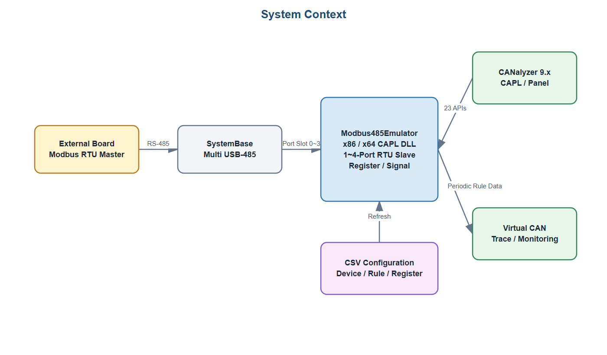
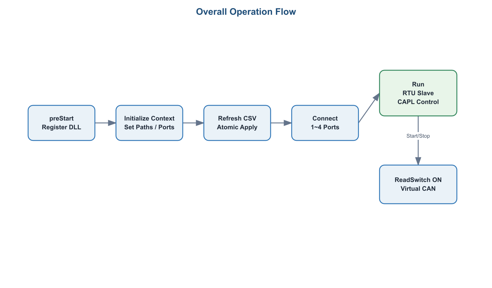
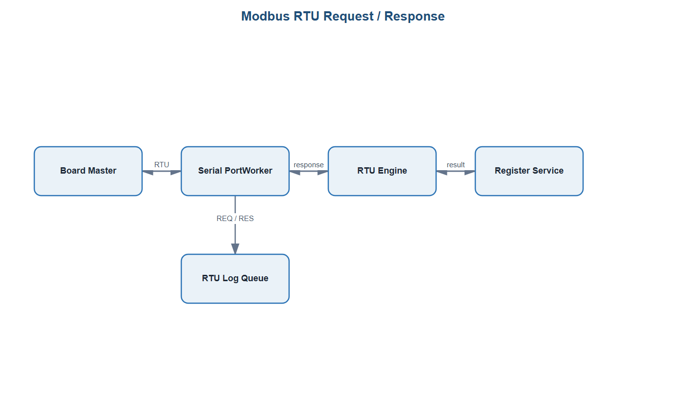
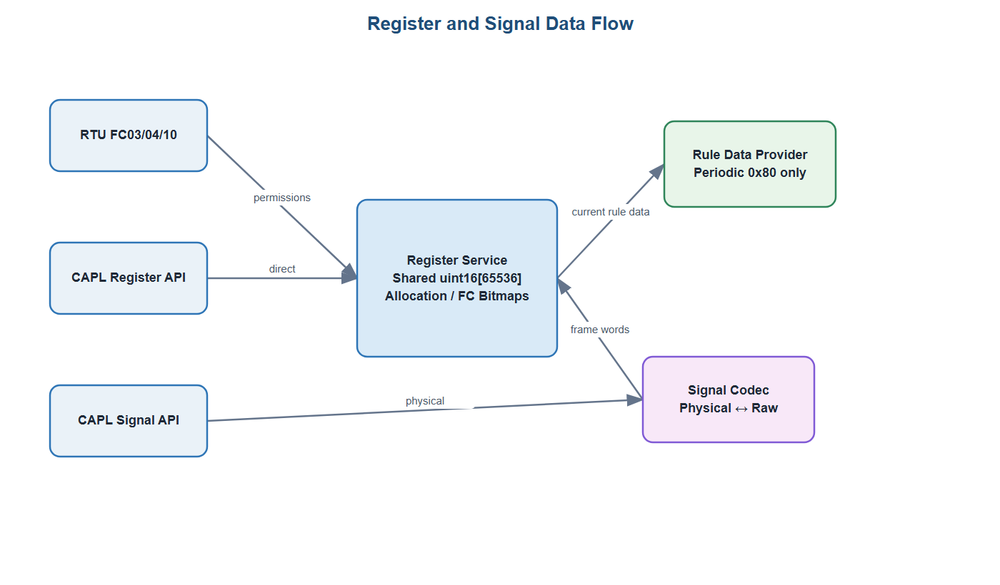
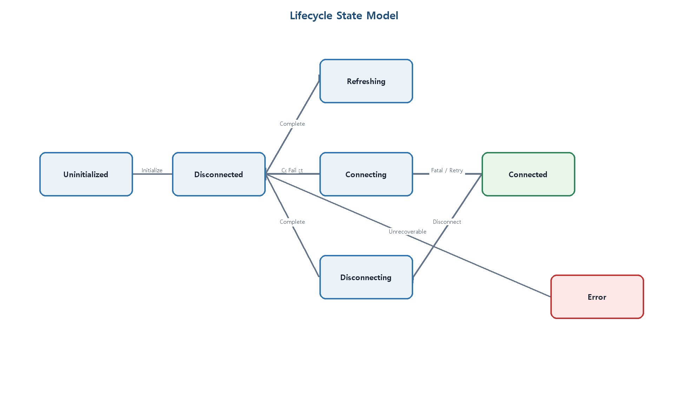

# Modbus485Emulator 한눈에 보기

> Release baseline: v0.4.0 (2026-08-13)

`Modbus485Emulator`는 Windows PC에서 실제 Modbus RTU Slave 장치 여러 대를 흉내 내고,
그 Register 상태를 CANalyzer의 가상 CAN 채널로 관찰할 수 있게 하는 Windows x86/x64 CAPL DLL이다.
Board는 RS-485를 통해 Master로 요청하고, CANalyzer의 CAPL·Panel은 Emulator의 설정,
수동 조작과 Monitoring 출력을 담당한다.

> 현재 구현 기준: CANalyzer 9.x용 Windows x86와 CANalyzer 18용 Windows x64, RS-485 Port 1~4개, FC03·FC04·FC10,
> Device 최대 256개, Monitoring Rule 최대 200개, Signal 최대 4,096개.

## 1. 시스템 구성



| 구성 요소 | 역할 |
|---|---|
| Board | Modbus RTU Master로 FC03·FC04 Read와 FC10 Write 요청 전송 |
| SystemBase Multi USB-485 | 자동 방향 제어 방식으로 PC와 Board의 RS-485 연결 |
| `M485E.dll` | CSV 검증, 장치/Register 상태, RTU Slave, Queue와 연결 수명주기 처리 |
| CAPL Core | 23개 저수준 DLL API를 CAPL용 함수로 감싸고 Context·공통 오류를 관리 |
| CAPL Monitoring | ReadOption과 출력 Timer를 관리하고 현재 Rule Data를 가상 CAN Message로 변환 |
| CAPL ReadOption | 프로젝트 FrameRule의 `slot ↔ Index + Rule_ID` 고정 목록을 한곳에서 관리 |
| CAPL Connection | ConnectSwitch, 500ms 자동 연결 Timer와 Connect/Disconnect 요청을 관리 |
| CAPL Control | Refresh와 100ms Lifecycle 상태를 LED·문자열 System Variable로 변환 |
| CAPL DeviceCommunication | Index별 외부 RTU 응답 On/Off와 Available LED를 100ms마다 동기화 |
| CAPL RtuLog | bounded DLL Queue를 배출해 요청·응답 CSV 파일을 기록하고 Log LED를 관리 |
| CAPL UI | Manual Write, Signal과 Monitoring System Variable 요청을 캡처해 공개 진입점에 전달 |
| CAPL Main | 프로젝트 경로·Port 초기 설정과 Measurement 시작·종료 순서를 관리 |
| CANalyzer Panel | System Variable을 사람이 조작하는 화면. 실제 `.xvp` Panel은 후속 작업 |

Core만 `M485E_Dll_*`을 직접 호출한다. Connection·Control·UI는 System Variable과 Panel
표현을, Monitoring은 CAN Message 생성과 스케줄링을 소유하며 Core는 표현 계층에 의존하지 않는다.

RS-485 Port Slot 0~3은 Main에 설정한 가상 CAN Channel과 1:1로 대응한다. 기본 1-Port
예제는 Slot 0을 Channel 1에 출력한다. 가상 CAN은 외부
물리 장치에 송신하기 위한 것이 아니라 Emulator 내부 Register 상태를 Trace에서 보기
위한 진단 경로다.

## 2. CSV가 만드는 실행 모델

| 파일 | 핵심 내용 | DLL에서 만들어지는 정보 |
|---|---|---|
| `M485E_Device.csv` | `Index`, COM Port, Slave ID | Device Index를 `Port + Slave ID`로 연결 |
| `M485E_FrameRule.csv` | `Index`, `Rule_ID`, FC, Address, Quantity | RTU 접근 권한과 CAN Monitoring 범위 |
| 장치 유형별 `*_RegisterMap.csv` | Address, SignalName, Type, Bit 배치, Scale, Init Value | Register 초기값과 물리 Signal 변환 정보 |

CAPL은 DeviceMap과 FrameRule 두 경로만 DLL에 전달한다. 각 DeviceMap 행의
`CSV_DB_Name`이 DeviceMap 파일이 있는 디렉터리를 기준으로 장치 유형별 Register Map을
지정한다. 같은 실물 유형의 장치는 같은 Map을 공유할 수 있지만 Register 현재값은 Index별로
독립적이다. `M485E_FILE_EMULATOR_MAP` 상수와 API는 ABI 호환을 위해 남아 있으나 신규
Refresh에서는 필수 경로로 사용하지 않는다.

Device Index는 CAPL과 DLL에서 장치를 선택하는 공통 식별자다. 같은 COM Port에 여러
Slave ID가 있어도 각 장치는 서로 다른 Index를 갖고, Port 설정은 고유 Port마다 한 번만
전달한다.

```text
Device Index
    ├─ M485E_Device.csv     → COM Port + Slave ID
    ├─ M485E_FrameRule.csv  → FC03/FC04 범위 + Rule ID
    └─ CSV_DB_Name          → 장치 유형 Register Map + Signal 정의 + Init Value
```

Address는 CSV에 적힌 숫자를 그대로 Modbus PDU Address로 사용한다. `40001` 표기 변환이나
`-1` 보정은 하지 않는다. `M485E_FrameRule.csv`의 FC03 범위는 FC10 Write가 가능하고,
FC04 범위는 외부 RTU Write가 허용되지 않는다. CAPL의 Direct Read/Write는 디버그 경로라
유효 Register라면 FC03·FC04 구분 없이 접근할 수 있다.

## 3. 시작부터 종료까지



1. CANalyzer가 `M485E_Main.can`을 로드한다. 9.x는 x86 DLL을 직접 연결하고 13 이상은 `M485E.vmodule`에서 실행 아키텍처에 맞는 DLL을 선택한다.
2. CAPL `preStart`에서 현재 Program Node를 등록하고 Vector Context Handle을 얻는다. Handle 값 0도 정상값이다.
3. CAPL `start`에서 DLL Context를 초기화하고 DeviceMap/FrameRule 경로와 활성 Port 1~4개의 Serial 설정을 전달한다.
4. DLL이 DeviceMap에서 참조하는 Register Map까지 비동기로 읽고 전체 검증에 성공하면 새 Runtime Model을 원자적으로 적용한다.
5. 시작 구성이 접수되면 Main이 `ConnectSwitch`를 자동으로 켠다. 500ms 뒤 연결 Timer가 Refresh 완료를 확인하고 DeviceMap의 모든 활성 COM Port를 한 번에 연다. 하나라도 실패하면 전체 Connect를 실패시키고 Switch를 다시 내린다.
6. Connected 상태에서 Board RTU 요청, CAPL 수동 조작과 CAN Monitoring을 병행한다.
7. Measurement 종료 시 Monitoring과 Timer를 중지하고 Worker를 취소·Join한 뒤 COM과 Context를 정리한다.

CSV Refresh는 Disconnected 상태에서만 허용한다. Refresh에 성공하면 기존 Runtime
Register 값은 폐기되고 새 CSV의 `Init_Value`로 전체 Register Memory가 재구성된다.
Periodic Pending 관련 상태도 초기화되므로, 보존할 값은 Refresh 전에
사용자가 별도로 기록해야 한다.

새 CSV에 오류가 있으면 임시 Configuration과 Memory를 적용하지 않고 Last-good
Configuration과 Register 값을 유지한다. 다만 오류를 수정해 Refresh가 다시 성공하기
전까지 Connect는 거부한다. 오류에는 파일 종류, 행, 칼럼과 Error Code가 포함되며 CAPL
Core가 Write Window 메시지로 정리한다.

## 4. Board가 Modbus RTU를 요청할 때



각 Port Worker는 독립적으로 다음 순서를 처리한다.

1. COM에서 최대 256Byte Chunk로 읽고 Read Timeout과 관계없이 미완성 후보를 이어 붙인다.
2. FC03·FC04·FC10 예상 길이와 CRC-16으로 Frame을 복구하고, 미지원 Function은 bounded CRC sliding으로 분리한다.
3. 수신 Port와 Slave ID로 Device Index를 찾는다.
4. Function Code와 Address 범위를 `M485E_FrameRule.csv` 권한과 대조한다.
5. CRC 유효 요청 뒤 계산된 t3.5 Guard를 보장하고 FC03·FC04는 Register를 읽어 응답하며, FC10은 Register를 쓴 뒤 정상 응답한다.
6. FC10으로 바뀐 값은 다음에 선택된 `0x80` Periodic Monitoring에서 최신 Rule Data로 출력된다. RTU 로그가 켜져 있으면 요청과 응답 또는 무응답 결과는 CSV에 기록된다.

미등록 Slave에는 응답하지 않는다. Slave ID 0의 FC10 Broadcast는 수신 Port에 구성된 모든
통신 활성 Device를 전체 검증 후 원자 적용하고 응답은 보내지 않으며, Broadcast FC03/FC04는 무응답·무적용이다.
Register Address 0은 Slave ID 0과 별개의 정상 주소다. 등록 Slave의 미지원 Function이나
잘못된 Address·Quantity는 Modbus Exception으로 응답한다. 한 Port의 처리 지연이 다른
Port를 막지 않도록 Port별 Worker와 Framing 상태를 분리한다.

`DeviceCommunication::Enabled[Index]`를 0으로 바꾸면 해당 Device만 외부 Master에게 없는
Slave처럼 동작한다. 같은 Port의 다른 Slave와 COM 연결은 유지되며 Direct Register/Signal
제어와 가상 CAN Monitoring도 계속 동작한다. `AvailableLed[Index]`는 실제 Connected 상태와
Enabled 상태가 모두 만족될 때만 1이다.

## 5. RTU 요청·응답 CSV 로그

`RtuLog::LogSwitch`를 켜면 새 `Logs/M485E/M485E_RTU_YYYYMMDD_HHMMSS.csv`를 만들고
Master 요청과 Emulator 결과를 Transaction별 두 행으로 기록한다. DLL Worker는 파일에 직접
쓰지 않고 256개 Transaction bounded Queue에 게시하므로 디스크 지연이 RTU 응답을 막지 않는다.

- `REQ`: 수신 요청 전체 ADU와 Port, Slave, Index, DeviceName, FC, Address, Quantity
- `RES`: 실제 송신에 성공한 정상/Exception 응답 전체 ADU
- `NO_RES`: DeviceDisabled, BroadcastNoResponse, UnknownSlave, CrcError, InvalidFrame 또는 ResponseSendFailed
- 같은 Transaction의 REQ와 결과는 같은 Sequence를 사용하고 각 파일에서 1부터 시작
- OFF 시 신규 capture를 중지하고 남은 쌍을 모두 기록한 후 닫으며 `ActiveLed`를 끔

별도의 CAN ID는 만들지 않는다. 가상 CAN Monitoring은 Register 상태 관찰용이고 RTU CSV는
실제 Master 요청/응답 추적용이라 서로 독립적으로 켜고 끌 수 있다.

## 6. CAPL과 Panel이 값을 조작할 때



Panel은 DLL을 직접 호출하지 않고 System Variable을 변경한다.

```text
Panel/System Variable
        ↓
M485E_UI.cin
        ↓
M485E_Core.cin
        ↓
M485E.dll Runtime Register Model
```

- Manual Write: `Index + StartAddress + Quantity + Data[122]`를 전달해 최대 122개의 16bit Register를 한 번에 쓴다. 값 편집만으로는 쓰지 않고 `Send`에서 요청 전체를 적용한다.
- Signal Read: `Index + SignalName`을 요청하고 `PhysicalValue`로 물리값을 받는다.
- Signal Write: `Index + SignalName + PhysicalValue`를 전달하며 Scale·Offset과 자료형 변환을 적용한다.

수동 Register Read와 AutoRead Panel은 제공하지 않는다. CAN Monitoring과 CAPL/DLL의 공개
Register Read API는 유지하며, Register별 읽기 표시 System Variable 연결은 인터페이스 확정
전까지 보류한다.

Signal Type은 `Signed`, `Unsigned`, `IEEE Float`, `IEEE Double`을 지원한다. 다중 Register
값은 첫 Address에 High Word가 오는 `HighWordFirst`로 고정한다. `Byte_Order=LittleEndian`은
각 16bit Register 내부의 High/Low Byte만 바꾸며 Register 사이의 Word 순서는 바꾸지 않는다.

Direct Write, Signal Write, Reset과 Board의 FC10 Write는 Register Memory만 변경한다. 별도
변경 CAN Event는 만들지 않으며 다음에 선택된 `0x80` Periodic 출력이 최신값을 반영한다.

## 7. 가상 CAN Monitoring

Monitoring은 DLL이 스스로 주기 송신하지 않는다. CAPL이 활성화된 `ReadOption`을 관리하고
DLL에서 현재 Rule Data를 읽어 CAN Message를 생성한다.

- Monitoring Cycle: CAPL 코드의 공통 1,000ms Timer
- Output Pump: 10ms Timer
- Rule 선택: `M485E::Monitoring::Check_ReadOption[]`
- Periodic Rule: Port별로 Cycle이 끝나도 이어지는 ReadOption Cursor와 시작 Port Round-robin
- Periodic Monitoring: `0x80IIRRMM`

`II`는 Device Index, `RR`은 Rule ID, `MM`은 Message Index다. 모든 Message는 Extended
CAN으로 출력한다.

### Header Message

- `MM=0x01`, DLC 8
- Index, Slave ID, Function Code, 고정 SourceType `0x00`
- 시작 Address와 Quantity

### Data Message

- `MM=0x02`부터 순차 증가
- Address 오름차순으로 Message 하나에 Register 최대 4개
- Register는 High Byte, Low Byte 순으로 적재
- 마지막 Message DLC는 실제 Register 수 x 2이며 빈 공간을 Padding하지 않음
- 총 Frame 수는 `1 + ceil(Quantity / 4)`

Monitoring을 켤 때 별도 Init 또는 Change Event는 만들지 않는다. 선택된 Rule은
Header Byte 3을 `0x00`으로 기록하는 `0x80` Periodic 경로에서 첫 Cycle부터 처리한다.

프로젝트에 적용할 때 `M485E_FrameRule.csv`의 각 Device Rule 구간을
`M485E_ReadOption.cin`의 `M485E_ReadOption_ConfigureAll()`에서
`M485E_ReadOption_ConfigureDevice(Index, StartReadOption, EndReadOption)`로 등록한다.
함수는 해당 Device의 Rule ID를 1부터 연속 생성한다.
Slot은 0부터 빈칸 없이 증가해야 하고 같은 `Index + Rule_ID`의 중복 등록은 거부된다.

Periodic 출력은 시작 Port를 순환하고 Port별 Cursor를 별도로
유지하므로 한 Port에 Rule이 집중되어도 다른 Port의 Rule이 영구적으로 밀리지 않는다.

## 8. 연결 끊김과 오류 복구



- Connect와 Disconnect는 CAPL Event를 막지 않도록 비동기로 처리한다.
- 활성 Port 중 하나가 끊기면 Monitoring을 중지하고 모든 활성 Port를 닫은 뒤 전체 재연결을 시도한다.
- 자동 재연결은 3초 간격, 최대 10회다.
- 중간에 성공하면 Connected로 돌아가고 요청된 Monitoring을 복구한다.
- 모두 실패하면 Disconnected 상태와 Error Event를 남긴다.
- 자동 재연결을 모두 소진하면 ConnectSwitch도 OFF로 동기화하여 수동 재연결을 기다린다.
- Measurement Stop은 재연결 대기 중에도 취소하고 모든 Worker와 COM Handle을 정리한다.

동기 API 오류는 Context별 Last Sync Error에, Worker·연결 같은 비동기 오류는 bounded
Error FIFO에 기록한다. Queue가 가득 차면 oldest-drop 정책과 Drop Count로 손실을
진단하며, Worker가 CANalyzer Write Window를 직접 호출하지 않는다. CAPL Control은
100ms 상태 Polling에서 Error Queue 통계를 함께 조회하고, DropCount가 변하거나 Overflow
Latch가 처음 1로 전환될 때만 Pending·Capacity·High-water Mark·DropCount·Latch를 Write
Window에 출력한다. 따라서 반복 오류 Burst를 계속 출력하지 않으면서 진단 손실은 확인할 수 있다.

## 9. 코드와 파일 위치

| 위치 | 내용 |
|---|---|
| `src/M485E.Core` | CSV, Register/Signal, RTU, Queue, Framing과 Port Worker |
| `src/M485E.Dll` | CAPL Export Table, Context, Lifecycle, Win32 Serial Adapter |
| `Config/CAPL/M485E` | Main, Core, Monitoring, UI CAPL 코드 |
| `Config/System Variables/M485E.vsysvar` | Panel 연동 System Variable 정의 |
| `Config/Maps/M485E` | 기본 DeviceMap, FrameRule 및 장치 유형별 Register Map |
| `spec` | 오류 코드와 공개 상수의 단일 원본 |
| `generated` | spec에서 생성한 C++·CAPL 계약 |
| `tests` | ABI, Core, Integration, CAPL 계약과 실환경 Probe |
| `examples/M485E_Test` | 저장소 자체 완결형 Device A/B Map, Panel 가이드와 검증 체크리스트 |
| `docs/05_Test` | 대상 실환경 검증 가이드와 결과 기록서 |
| `dist/M485E.vmodule` | CANalyzer 13 이상에서 아키텍처별 DLL을 선택하는 Manifest |
| `dist/Windows-x86/M485E.dll` | CANalyzer 9.x에 배치할 Release/x86 DLL |
| `dist/Windows-x64/M485E.dll` | CANalyzer 18에 배치할 Release/x64 DLL |

## 10. 처음 실행하는 순서

1. Solution을 `Release/Win32`와 `Release/x64`로 빌드하여 두 DLL과 `M485E.vmodule`을 만든다.
2. `tools/Prepare-M485EPackage.ps1 -Configuration Release`로 Manifest와 DLL을 `Config/CAPL/Dll`에 배치한다.
3. CANalyzer Configuration에 `M485E.vsysvar`를 등록한다.
4. Program Node에 `M485E_Main.can`을 연결한다.
5. Main의 COM 번호와 Serial 설정, CSV 상대경로를 실제 환경에 맞춘다.
6. Measurement를 시작하면 ConnectSwitch가 자동으로 ON 된다. `ConfigurationValid=1`, `ConnectedLed=1`, `State=Connected`를 확인한다.
7. 필요하면 ConnectSwitch를 OFF로 내려 Manual Register Write와 Signal Read/Write를 확인한다.
8. 자동 Connect가 실패했다면 USB-RS485와 Board 연결을 확인하고 `ConnectSwitch`를 다시 켠다.
9. DeviceCommunication Enabled/Available LED, FC03·FC04·FC10과 가상 CAN Trace, 재연결을 순서대로 시험한다.
10. RtuLog LogSwitch를 ON하고 Master 요청 후 `Logs/M485E`의 REQ/RES 또는 REQ/NO_RES 쌍을 확인한다.

대상 환경에서 수행할 상세 순서는
[`examples/M485E_Test/VALIDATION_CHECKLIST.md`](../examples/M485E_Test/VALIDATION_CHECKLIST.md)를
따르고 결과는 `docs/05_Test/Modbus485Emulator_External_Test_Result.xlsx`에 기록한다.

## 11. 현재 완료 상태와 남은 검증

자동 Build, ABI Probe, Core Unit Test, DLL Integration Test와 CAPL 소스 계약 검사는
완료되어 있다. 다음은 실제 대상 환경에서 확인해야 한다.

- CANalyzer 9.x SP8에서 x86 DLL Load와 전체 Main CAPL Compile/Measurement
- CANalyzer 18에서 `M485E.vmodule`을 통한 x64 DLL 선택, 전체 Main CAPL Compile/Measurement
- SystemBase Multi USB-485와 실제 Board의 FC03·FC04·FC10 응답시간
- COM 분리·복구와 3초 x 10회 자동 재연결
- 두 가상 CAN Channel의 Extended Header/Data Message
- 프로젝트별 Device, Rule 및 Register CSV의 실제 Address 매핑
- 최대 200 Rule의 Periodic 출력과 장시간 안정성
- SystemBase Multi USB 485와 실제 Board에서 RTU Chunk 분할·병합, 응답 Timing 및 Noise 재동기화 검증
- 장치별 탭을 포함한 실제 CANalyzer Panel `.xvp`

x86/x64 DLL의 자동 Build·ABI 검증은 완료되어 있다. CANalyzer 9.x와 18에서 실제 Measurement를 수행하는 항목은 대상 실환경 검증으로 남아 있다.
